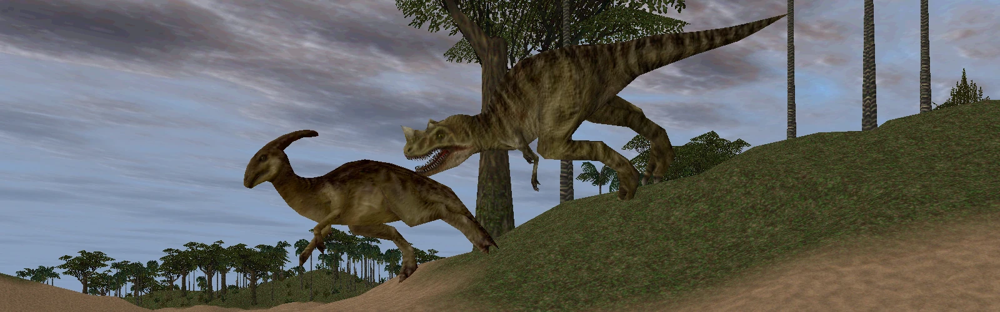

<p align="center">
  
</p>

*Actual gameplay captured from the Rust reimplementation of Carnivores 2 1998. Not footage from the original PC release.*

# Carnivores Classic, rebuilt in Rust for PC, 3DS and beyond

A fan-made, ground-up Rust rewrite of **Carnivores 2** (Action Forms, 1999), with a mod system that can combine community mods automatically, and ports to the **Nintendo 3DS**, the **Wii U**(work in progress) and **PC VR** (work in progress).

You need your own copy of Carnivores 2: this project contains **no game files and no mod files**, only
code, documentation and recipes (lists of credits, download links and file hashes).

**v0.5.0:** [Release notes](docs/releases/v0.5.0.md) · [Changelog](CHANGELOG.md) · [Public roadmap](docs/ROADMAP.md)

---

## Why this exists

This is a passion project. Carnivores Classic has been one of my favourite games for a long time. It's a game I grew up with and the overall tense feeling of hunting while potentially being hunted always stuck with me. This project is my way of showing how much I admire the game, and the community that has kept it alive for over twenty-five years!

The goal is to make the game **more accessible while staying faithful to it**. The original game's
behaviour is the vision. Anything this rewrite has that is different, that's a bug or a documented choice
(`docs/DECISIONS.md`), never an "improvement" slipped in quietly. If you are looking for a fully 
modernized version of Carnivores, I urge you to check out [Carnis](https://cce.carnivoressaga.com)! Although we will add some optional 
settings for some QOL changes I wanted to see, we aim to preserve the functionality of the base game
and for it to be accessible on multiple platforms.

The modding community has been absolutely amazing. There are new animals, weapons, maps, whole
standalone games, and the Modder's Edition Engine. It can also feel a bit daunting. Different mods are
built for different engines and executables, each install is its own copy of the game, and getting
several mods running together can mean a lot of manual file shuffling. This project aims to:

- **Bridge the gap between the engines.** It plays the original game's data, the Modder's Edition
  Engine's `_RES.TXT` dialect, and standalone games made from Carnivores 2, all from one engine. It can
  also combine add-ons and whole games into one install.
- **Bring your favourite mods, or your favourite version of the game, to other devices.** You can play
  the same game, with the same add-ons, on a PC, a 3DS, a Wii U or in a VR headset.
- **Respect the people who made it all.** Recipes share a mod setup by credit, link and file hash only,
  so everyone downloads mods from their authors' own pages.

I know it isn't feasible to get the game running on every console or device ever made, but that won't
stop me from trying. This is also an ongoing exploration of what AI can do when adapting code for very
different systems: much of the work is done together with Claude and ChatGPT, from reading the original C++ to
the 3DS's PICA200 GPU and the Wii U's PowerPC CPU.

---

## Status

| Platform | State | Notes |
|---|---|---|
| **PC** (Linux; Windows experimental) | Playable, feature-rich | The full original game, plus add-ons, Modder's Edition games, standalone games, Carnivores: Ice Age, animals from the mobile games, survival mode and a balance editor. Bugs mostly show up when a lot of mods and add-ons are used at once. Working on smaller bugs and optional quality of life features |
| **Nintendo 3DS** (homebrew) | Nearly complete | Full hunts, touch menus, bottom-screen map, sound, saves, trophy room, add-on and standalone packs, `.cia` installs. Tested on real 3DS and 2DS hardware. Optional settings help with the handheld controls (see [below](#3ds-settings-for-handheld-play)). Like PC, bugs mostly come from packing in too many add-ons or mods. |
| **Wii U** (homebrew) | Demo, being optimized | Stock Carnivores 2 only: an HD menu (TV and GamePad) with dawn/day/night and all the original gear and options, all five maps, the nine animals, six weapons, calls, radar, GamePad map. Runs on a real Wii U under Aroma (`.wuhb`) and exits to the HOME menu cleanly. A steady 30 FPS in open areas; 20-25 FPS in thick jungle, where the GPU is the limit (measured on hardware). New and not yet tested on the console: survival, the trophy room, saved trophies and score (the PC's save format), the PC's kill notice and trophy plaque, the hunter record, and an exit prompt and pause. New: any game as its own Wii U Menu entry: add-ons, the Modder's Edition and standalone games such as Triassic and Mandibles. |
| **PC VR** (OpenXR) | Early first draft | Menus and the hunt setup on a panel, walking the areas, animals that hunt you. No weapons yet. Tested with a PS VR2 on Linux through Monado. |
| **Android** | First build: menus run, tested on android device. Controller and touch controls work | The PC game in an APK, for a game built from your own mobile APK (Dinosaur Hunter or Ice Age), plus add-ons and standalones combined beside it on the PC; at most 8 animals and 8 weapons per hunt. See [`android-ver/README.md`](android-ver/README.md). |
| **PS5 / PS VR2** | Not started | Research notes only (`psvr2-ver/gameplan.md`). Mainly looking at an optimized PSVR2 setup since the PS5 CFW community is already working on translation layers for PC games to run |

The launcher can also rebuild a base game from your own supported Android APK, with add-ons on top.
Mobile conversion and mixed-mod compatibility still need further gameplay testing; see the
[roadmap](docs/ROADMAP.md) for current priorities.

Survival offers **Classic** (stock animals; hidden on standalone rosters) and
**Modded** (eligible stock and installed mod animals). Neither requires an APK.
Waves use hunt-menu prices and a separate budget that grows 10% per round.
The starting budget defaults to twice the cheapest eligible dangerous animal's
price (minimum 10). PC Game options can override it; packs can set
`survival_start` in the menu script's `prices` section on all platforms.
Choosing Classic or Modded starts immediately on Mount Ravan in the mobile
survival ravine, with a shotgun only. Waves come from the fixed approach;
ordinary map wildlife is removed. Movement remains enabled.
Console memory and wave limits still apply.

**Hardcore survival** (PC; off by default, not part of the original game): turn on
Game options > "Enable hardcore survival mode" and a third choice appears. It has
Modded's waves, but at a night that never ends, as pitch black as the dynamic
day cycle's midnight, with the flashlight, the radar and the shotgun.


---

## What you need

- **Your own Carnivores 2 install**: the folder that contains `HUNTDAT/`. ReShade or other wrapper DLLs
  in it are ignored.
- **Building from source:** stable Rust for PC (<https://rustup.rs>). Downloaded Windows
  builds do not need Rust or C++ build tools; see [Windows installation](#windows-installation).
  The 3DS and Wii U source builds also need nightly; see their sections.
- Optional: mods you've downloaded, each in its own folder (or as a `.zip`; extract `.rar` and `.7z` separately
  before adding their folders). Carnivores: Ice Age and the mobile games' APKs can be imported too.

On Linux, the PC build needs the ALSA and udev headers:

```sh
sudo apt install build-essential pkg-config libasound2-dev libudev-dev   # Debian / Ubuntu
sudo dnf install gcc pkgconf alsa-lib-devel systemd-devel                 # Fedora
sudo pacman -S base-devel alsa-lib                                        # Arch
```

---

## The easy way: the launcher (GUI)

The launcher sets up the game, manages mods, plays on PC, and builds 3DS and Wii U installs, without the
command line.

```sh
git clone https://github.com/isaiahboland-dotcom/Carnivores-Rust-Rewrite-and-ConsolePorts.git c2rs
cd c2rs/pc-ver
cargo build --release          # builds c2-pc, the launchers and c2-vr into pc-ver/target/release/
cargo run --release -p c2-launcher --bin c2-launcher   # or ./target/release/c2-launcher
```

Three builds of the same app:

| | |
|---|---|
| `c2-launcher` | play on PC and package Windows instances, with optional 3DS and Wii U sections |
| `c2-3ds-builder` | 3DS installs only (`cargo run --release -p c2-launcher --bin c2-3ds-builder`) |
| `c2-wiiu-builder` | Wii U installs only (`cargo run --release -p c2-launcher --bin c2-wiiu-builder`) |

The launcher opens on **Instances**: a grid of boxes, one per instance (a whole game: a base game, its
add-ons and its choices), sized to the window, plus **New instance**. Each box shows the base game, how
many add-ons, a yellow **⚠ N missing** when its base game or downloads can't be found, and the time
played (or **Unplayed**). **Import recipe…** copies in a recipe someone shared. **Settings** is the only
other tab.

- **Play** checks the instance's downloads and its base game, then builds the combined game (cached
  until something changes) and starts it. Missing downloads are listed with their download pages.
- **Build** asks which platform: **Windows** (experimental), **3DS** or **Wii U**, then shows only that
  builder; **Cancel** at the bottom goes back. Output, packaging and artwork choices are remembered
  separately for each instance. The 3DS and Wii U builders only offer their own platform.
- **Options** (or a right click on the box): **Edit**, **Clone**, **Fix missing**, **Export…** (the recipe
  to share, with its base game's hash list and patches), **Play in VR** and **Delete**. **Fix missing** looks through the mod and add-on folders set in Settings for the instance's
  base game and downloads and keeps what it finds: drop new downloads into those folders, then run it.

**Edit** shows the instance's own pages, with **Save**, **Save and exit**, **Discard changes** and
**Cancel** at the bottom:

- **Base game**: the instance's name and its game folder: your Carnivores 2 (or Ice Age) folder, a game
  built from your APK (**Build from my APK…**), or a standalone mod used as the base game on its own.
  The folder is checked against the base game's file hashes, so a wrong game shows up here. Pinned
  overlays (such as the Modder's Edition), **Pick parts** for the base game, and the **Menu** choice.
- **Add-ons**: standalone games (combined beside the base; **Pick parts** keeps only the areas, animals
  and weapons you want) and add-ons in load order, each with its folder. Animals can also be imported
  from Ice Age or the mobile games' APKs. Drop folders on the window to add them.
- **Balance**: PC or phone rules, and every area, animal and weapon with its price and score, plus the
  starting points. **Refresh list** reads them again after the other pages change. Changes are kept in
  the instance, never written into the game.

**Launch protection:** each instance keeps its own game folder, and Play and the builds stop when that
folder's files don't match the base game the recipe names (its SHA-256 hashes). Use the right folder, or
tick **Use this game anyway** when it is another version of the same game.

---

## Windows installation

1. Use a **64-bit Windows** system with working graphics/audio drivers. In a VM,
   install its guest graphics drivers/tools and enable 3D acceleration if available;
   compatibility depends on the graphics API exposed by that VM.
2. Open the [Windows workflow](https://github.com/isaiahboland-dotcom/Carnivores-Rust-Rewrite-and-ConsolePorts/actions/workflows/windows.yml),
   choose a successful run for the revision you want, and download the
   **c2rs-windows-x64** artifact (GitHub sign-in may be required). Extract the ZIP.
   The executables are under `pc-ver/target/x86_64-pc-windows-msvc/release/`.
3. Keep `c2-launcher.exe` and `c2-pc.exe` together. Open `c2-launcher.exe`, make a
   **New instance** with your own game folder (the one containing `HUNTDAT`) as its
   base game, then use **Play**. The download contains no game assets. A generated portable instance can instead be started
   by double-clicking its `c2-pc.exe`; keep its whole folder together.

Downloaded builds need **no Rust, Visual Studio build tools or devkitPro**.
Builds importing `VCRUNTIME140.dll` (including the inspected VM test executable)
need Microsoft's [Visual C++ x64 runtime](https://learn.microsoft.com/en-us/cpp/windows/latest-supported-vc-redist).
The CI configuration requests static C runtime linking; runtime dependencies must
still be verified for the executable being distributed. Graphics driver support
is required; original-game wrapper/ReShade DLLs are not dependencies.
Saves and settings are under `%APPDATA%\c2rs`.

To compile your own executables, you also need stable Rust (MSVC), Git if cloning,
and Visual Studio Build Tools with **Desktop development with C++** and a Windows
SDK. The [Windows guide](docs/WINDOWS.md) has PowerShell build commands,
packaging instructions and [diagnostic log capture](docs/WINDOWS.md#capture-a-diagnostic-log).

Windows remains experimental: CI and a VM run are evidence of progress, while
native hardware gameplay and broader compatibility testing are pending.

---

## PC from the command line

```sh
cd pc-ver
cargo run --release -p c2-pc -- play PATH/TO/Carnivores2
```

Register a hunter (or pick one copied from your install), then Hunt, Options, Trophy, Statistics and
Credits, as in the original. Your game folder is never written to. Saves go to
`~/.local/share/c2rs/` (the first run copies your game's saves).

PC game options support mouse-wheel scrolling and up/down arrows. **Dynamic time**
adds an optional 60-minute day/night cycle, starting at the chosen time. Wii U
has an experimental version; 3DS does not. See [timing and limitations](docs/DYNAMIC_TIME.md).

With mods:

```sh
cargo run --release -p c2-pc -- play GAME --mod ADDON_DIR --mod ADDON.zip              # add-ons
cargo run --release -p c2-pc -- play GAME --overlay "PATH/Carnivores 2" --mod ADDON    # on the Modder's Edition
cargo run --release -p c2-pc -- play GAME --standalone GAME_DIR                         # a standalone game beside the base
cargo run --release -p c2-pc -- play GAME --recipe ../recipes/c2-mee-addons.toml --mods DOWNLOADS --overlay "PATH/Carnivores 2"
```

**Controls:** keyboard and mouse follow your bindings (Options > Controls). A gamepad works too: left
stick moves, right stick looks, ZL draws, ZR fires, L binoculars, R map, A jump, B run, X call, Y next
weapon, D-pad up crouch / down change call, + pause, − exit. In the menus, the left stick moves a pointer,
A clicks, B goes back, and the right stick or D-pad scrolls lists.
Enable **Map zoom / pan** under **Options > Video** (off by default).
With the PC map open, use the wheel to zoom at the pointer, right-drag to pan,
and Home to restore the full map. Dynamic-time equipment uses N for night vision
and L for the flashlight (one at a time; the right stick click on a pad, or the
round nv / light buttons on the Android screen); select it under Equipment before the hunt.
Dynamic-time night kills earn +20% while night vision is off; using the
flashlight keeps that bonus. **K** switches the flashlight's beam between wide and a narrow one that
reaches farther (remembered for the next hunt).
**Multi ammo** (Options > Game, off by default): picking the tranquilizer asks **Half tranq** (each
weapon's rounds split between lethal rounds and darts; **T** swaps them, and the other kind loads when one
runs out; the top-left HUD shows "lethal:" and "tranq:" rows) or **Full tranq** (darts only, as the
original). **Advanced observer mode** (Options > Game): in observer hunts, teleport by the map with no
wait or cooldown, **F** flies (jump rises, crouch sinks), **T** stops time for camera shots.

**PC VR** (early): `cargo run --release -p c2-vr -- play GAME` with an OpenXR runtime running (SteamVR,
Monado, WiVRn). `c2-vr check` tells you which runtime it found. Plan and status:
`pc-ver/crates/c2-vr/GAMEPLAN.md`.

More: [docs/MODDING.md](docs/MODDING.md) (mods, recipes, balance files, standalone games) and
[docs/DEVELOPMENT.md](docs/DEVELOPMENT.md) (viewers, debug modes, design).

---

## 3DS settings for handheld play

Aiming and moving on a 3DS can feel awkward when a fast predator is on you, so the 3DS version has some
optional settings to make it easier (Settings on the title screen):

- **3DS friendly**: animals notice and chase you from a shorter distance (60% of the original's, within
  42 cells), so a far-off animal isn't a few pixels you have to snipe. Off by default: animals use the
  phone game's full 76 cells.
- **Dinosaur run speed**: a slider from 50% to 100% that slows every species by the same amount, so the
  differences between them stay. 100% is the original speed.

With both left at their defaults, the hunt plays as the original does at the mobile game's view range
(76 cells). The New 3DS draws all of it; the Old 3DS draws 56 cells, so there an animal can notice you
from just past the fog.

## Nintendo 3DS from the command line

Needs devkitPro (devkitARM, libctru, citro3d), Rust nightly with `rust-src` (selected by
`3ds-ver/rust-toolchain.toml`), `cargo-3ds` (`cargo install cargo-3ds`) and libclang. Details:
[docs/3DS.md](docs/3DS.md).

```sh
cd 3ds-ver

# 1. Cook your game into a pack (runs on the PC). Use --target n3ds for a New 3DS.
cargo run --release -p c2-cook -- --game PATH/TO/Carnivores2 --target o3ds --out c2rs.c2pk
#    add-ons:  --overlay "PATH/Carnivores 2" --mod ADDON --mod ADDON ...   (or --recipe R.toml --mods DIR)

# 2. Build the app.
export DEVKITPRO=/opt/devkitpro DEVKITARM=/opt/devkitpro/devkitARM
cargo 3ds build --release -p c2-3ds        # -> target/armv6k-nintendo-3ds/release/c2-3ds.3dsx

# 3. Optional: check a pack on the PC the way the 3DS loads it.
cargo run --release -p c2-cook -- --check c2rs.c2pk
```

On the SD card, put `c2-3ds.3dsx` in `/3ds/` and the pack(s) in `/3ds/c2rs/`. Start it from the Homebrew
Launcher; with more than one pack, it asks which to play. Each pack keeps its own saves. Packs are made
from your own files: keep them to yourself.

The launcher's **Build > 3DS** does all of this for you, and installs under a name of your choosing
(`sdmc:/3ds/<name>/`), so several installs can sit side by side.

### `.cia` builds (optional)

A `.cia` installs the game to the home menu (with FBI or a similar title manager). It needs two tools that
are **not part of this project**; download them yourself:
- **makerom**, from Project_CTR: <https://github.com/3DSGuy/Project_CTR/releases>
- **bannertool**: <https://github.com/Steveice10/bannertool/releases>

Put them beside the launcher or in its tools folder (on Linux and macOS, `chmod +x makerom bannertool`),
then use **Build > 3DS**, or (from `pc-ver/target/release/`):

```sh
c2-3ds-builder --cia NAME --tools DIR --out SD_DIR [--target o3ds|n3ds] [--icon PNG] [--banner PNG] [--sound WAV]
```

Each install name gets its own title ID and reads its packs from `sdmc:/3ds/NAME/`. The icon (48x48),
banner (256x128) and banner sound are your own. Without them, they're made from the game's own menu picture.

---

## Wii U from the command line (demo)

The Wii U version is a demo, tested in Cemu and on a real Wii U under Aroma. It's a C
frontend on devkitPro's WUT with the shared Rust code linked in. You need:

- Rust nightly with `rust-src`
- Docker, for the `devkitpro/devkitppc` image
- the third-party tools fetched into `wiiu-ver/tools/`, as described in
  [wiiu-ver/tools/README.md](wiiu-ver/tools/README.md)

From the repository root:

```sh
cargo +nightly build --release \
  --manifest-path wiiu-ver/perf-probe/Cargo.toml \
  --target wiiu-ver/perf-probe/powerpc-wiiu.json \
  -Z json-target-spec -Z build-std=core,alloc,compiler_builtins
docker run --rm --user "$(id -u):$(id -g)" \
  -v "$(pwd)/wiiu-ver/perf-probe:/src" -w /src devkitpro/devkitppc \
  sh -c '/opt/devkitpro/devkitPPC/bin/powerpc-eabi-objcopy --remove-section .note.GNU-stack target/powerpc-wiiu/release/libc2_wiiu_terrain_probe.a target/wiiu-terrain.a && /opt/devkitpro/portlibs/wiiu/bin/powerpc-eabi-cmake -S . -B build && cmake --build build'

# An install on the SD card: a game (as c2-cook takes it) and its own Wii U Menu entry.
# It finds c2-cook, the app and wuhbtool in this tree's builds, $DEVKITPRO/tools/bin or PATH (or --tools DIR).
cargo run --release --manifest-path pc-ver/Cargo.toml -p c2-launcher --bin c2-wiiu-builder -- \
  --install carnivores-triassic \
  --title "Carnivores Triassic" --sd SD -- --game "PATH/TO/Carnivores Triassic"
```

Everything after `--` goes to `c2-cook` (`--game`, `--overlay`, `--mods`, `--recipe`, `--balance`). Add
`--rpx` for a Homebrew Launcher build instead of a `.wuhb` (it reads `wiiu/apps/carnivores-probe/`).
To run it in Cemu, cook into Cemu's SD card (`c2-cook --target wiiu --out
~/.local/share/Cemu/sdcard/wiiu/apps/carnivores-probe ...`) and start the `.rpx`. Hardware frame-time captures and session results are kept locally in the ignored
`wiiu-ver/perf-probe/hardware-logs/` directory. Controls and the current state: [wiiu-ver/perf-probe/README.md](wiiu-ver/perf-probe/README.md);
the plan: [docs/WIIU.md](docs/WIIU.md) and [wiiu-ver/gameplan.md](wiiu-ver/gameplan.md).

---

## Recipes: sharing a mod setup

A recipe (`recipes/*.toml`) describes a modded game **without containing any of it**. Each mod is listed
with its authors' credit, its download page and the SHA-256 of every file used, plus the load order,
conflict choices and any small patches of our own. Anyone can rebuild the exact same game from their own
downloads. In the launcher, every instance is a recipe: put the file under `recipes/` and it shows on the
Instances screen.

**Using a recipe:**

1. **Pick a recipe** from the table below and open it. Each `[[mods]]` entry has the mod's `credit` and its
   download page (`url`).
2. **Download every mod** listed, from its page. **Unpack each one into its own folder**, all inside one
   downloads folder (`DOWNLOADS` below). The folder names don't matter: mods are recognised by their files.
3. **Get the base game and anything else the recipe's header asks for:**
   - your Carnivores 2 folder (`GAME`), or Carnivores: Ice Age for `ice-age-android.toml`;
   - for recipes on the Modder's Edition Engine, its [1.1.1 release](https://www.moddb.com/mods/carnivores-modders-edition/downloads/carnivores-modders-edition-111), unpacked. Use the folder
     `Carnivores Modders Edition 1.1.1 Standalone/Carnivores 2` as the `--overlay`;
   - for the `*-android` recipes and `c2-everything.toml`, import the mobile games' animals from your own
     APK first, into `DOWNLOADS`. The exact `c2-pc mobile ...` command is in the recipe's header.
4. **Check** that everything is there and matches:
   ```sh
   cd pc-ver
   cargo run --release -p c2-pc -- recipe verify ../recipes/c2-mee-addons.toml --base GAME --overlay "PATH/Carnivores 2" --mods DOWNLOADS
   ```
   It lists anything missing or different, with the link to get it.
5. **Play it**, or build it into a folder, or cook it for the 3DS:
   ```sh
   cargo run --release -p c2-pc -- play GAME --overlay "PATH/Carnivores 2" --recipe ../recipes/c2-mee-addons.toml --mods DOWNLOADS
   cargo run --release -p c2-pc -- recipe build ../recipes/c2-mee-addons.toml --base GAME --overlay "PATH/Carnivores 2" --mods DOWNLOADS --out DIR
   ```
   The 3DS command for each recipe is in its header.

The recipes here:

| Recipe | What |
|---|---|
| `c2-mee-addons.toml` | ten add-on animals on the Modder's Edition Engine 1.1.1 |
| `c2-everything.toml` | every add-on, plus the mobile Dinosaur Hunter's and Ice Age's animals (APKs needed) |
| `c2-android.toml` | Carnivores 2 with the mobile Dinosaur Hunter's animals (APK needed for these animals) |
| `ice-age-android.toml` | Carnivores: Ice Age with the mobile Ice Age's animals (APK needed) |
| `example.toml` | the format, not a real pack |
| `bases/*.toml` | hashes of the retail Carnivores 2 and Ice Age, to check a base game |

To make your own from mods you have (it pins every file they use):
`c2-pc recipe new MOD_DIR... --base GAME --id my-pack --out my-pack.toml`. See
[docs/MODDING.md](docs/MODDING.md#recipes).

---

## Testing changes

Much of this code is written with AI assistance, so every change is checked against the game's
actual behaviour, not only against unit tests:

- **Unit tests** (`cargo test --workspace` in `pc-ver/`, run by CI) use synthetic data only.
- **Gameplay regression scenarios** (`c2-regress`) play a scripted, deterministic hunt on your own
  game files: load an area, place four animals, fire every weapon once, open the binoculars, map and
  pickers. Each run records functional results, per-checkpoint simulation hashes, screenshots and
  timings, and compares them with a baseline from before the change and with the published vanilla
  baselines in `pc-ver/crates/c2-regress/baselines/`. An optimization must leave the hashes unchanged;
  a fix that changes them has to say why.
- **Original-engine runs** play the same script in the original Carnivores 2 and Ice Age under Wine,
  for a side-by-side comparison.

How to run them and what they do and do not prove: [docs/REGRESSION.md](docs/REGRESSION.md#validating-a-change).
Contribution rules: [CONTRIBUTING.md](CONTRIBUTING.md).

---

## Repository layout

| | |
|---|---|
| `pc-ver/` | Cargo workspace (stable Rust): the shared crates (`c2-formats`, `c2-vfs`, `c2-mods`, `c2-core`), the PC game (`c2-pc`), the launchers, PC VR (`c2-vr`), gamepads, the parity tools and the regression runner (`c2-regress`) |
| `3ds-ver/` | the 3DS app (`c2-3ds`) and the pack cooker (`c2-cook`); nightly, reuses `pc-ver/crates` |
| `wiiu-ver/` | the Wii U port: a series of probes for testing and the playable demo (`perf-probe`) |
| `android-ver/` | the Android APK build of the PC game ([README](android-ver/README.md)) |
| `steamdeck/` | Steam Deck install script for the launcher |
| `psvr2-ver/` | PS VR2 research notes |
| `recipes/` | mod recipes: credits, links and hashes only |
| `docs/` | [MODDING](docs/MODDING.md), [3DS](docs/3DS.md), [WIIU](docs/WIIU.md), [WINDOWS](docs/WINDOWS.md), [FORMATS](docs/FORMATS.md) (file formats), [REGRESSION](docs/REGRESSION.md) (gameplay regression scenarios), [ROADMAP](docs/ROADMAP.md), [RELEASING](docs/RELEASING.md), [SECURITY-HARDENING](docs/SECURITY-HARDENING.md), [DECISIONS](docs/DECISIONS.md) (every design choice and deviation), [DEVELOPMENT](docs/DEVELOPMENT.md) (spec and conventions) |
| `source/` | **gitignored**: your own game, mods and reference material (see DEVELOPMENT.md) |

---

## Legal

- This is an unofficial fan project, not affiliated with or endorsed by Action Forms, Tatem Games, or any
  mod author.
- No game data, mod files, or original source code are in this repository, and none ever will be.
  You supply your own copy of the game and download mods from their authors.
- The original Carnivores 2 C++ source, released publicly in 2013, was used **as a reference only**
  to match behaviour and file formats. This is a rewrite, not a translation. The same goes for the
  Modder's Edition Engine's public source and manual.
- The code in this repository is under the [MIT License](LICENSE).

## Thanks

- **Action Forms**, for Carnivores 2 and for releasing its source.
- **The Carnivores modding community**: every add-on, map, skin and standalone game author, and the
  creators of the **Modder's Edition Engine** and its modernized fork. The recipes credit each mod's authors
  and link to their pages; please download from them and support their work.
- The homebrew toolchains this builds on: **devkitPro** (devkitARM, devkitPPC, libctru, citro3d, WUT),
  the **rust3ds** project, **rust-wiiu**, and **Monado** for open-source VR on Linux.
- Built with the help of **Claude** and **ChatGPT**

Input limits, generated-install recovery and validation scope:
[Security hardening notes](docs/SECURITY-HARDENING.md).
