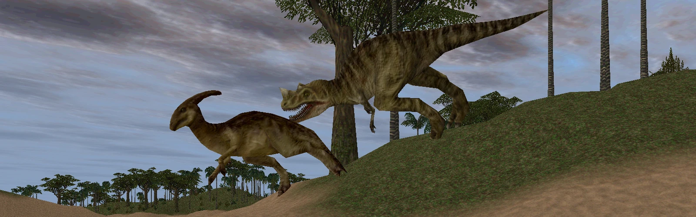
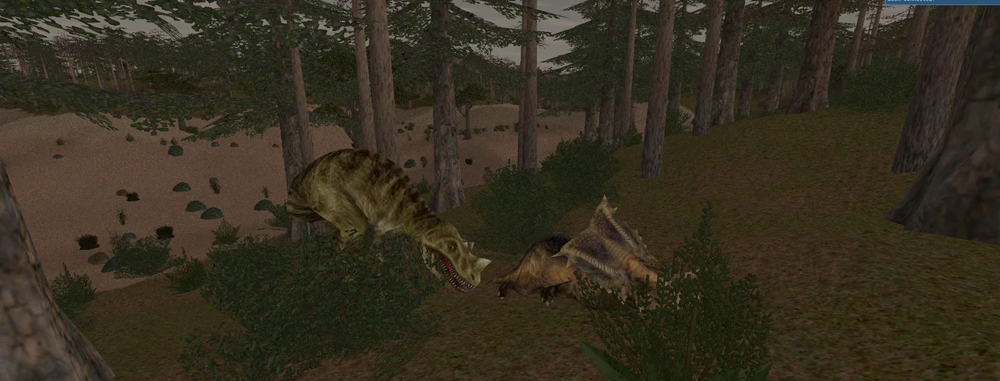
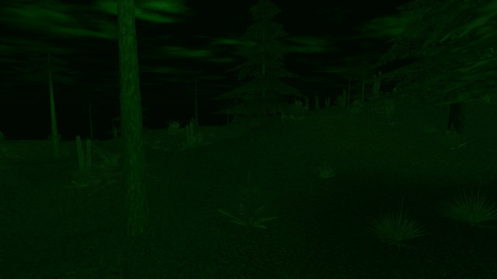
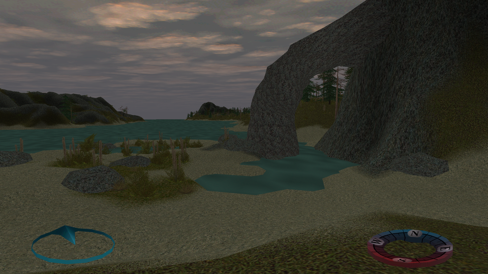
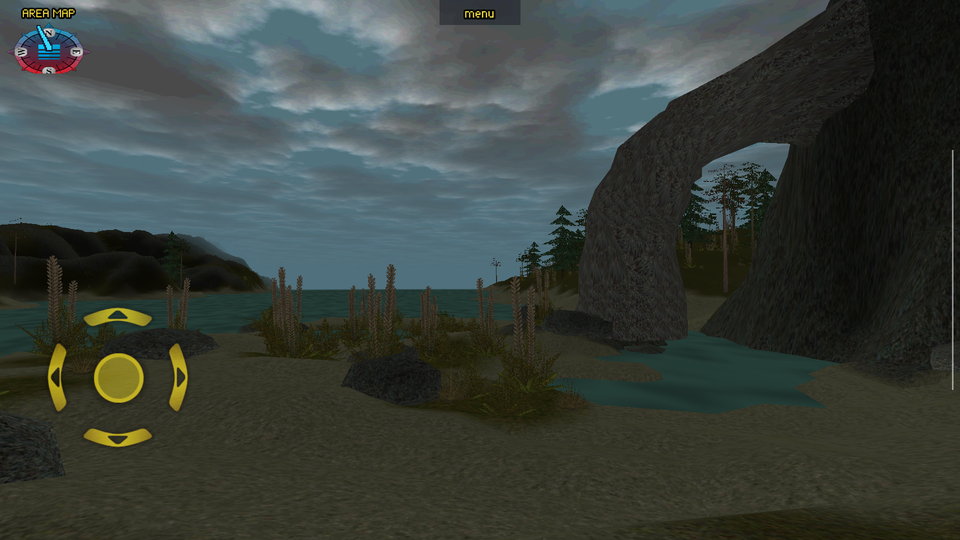
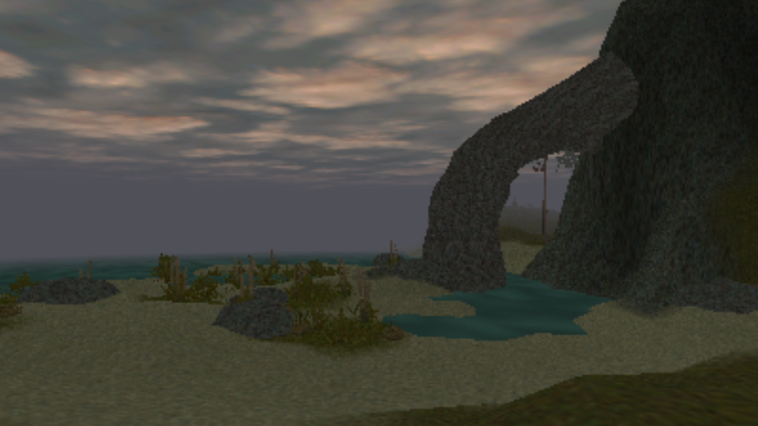
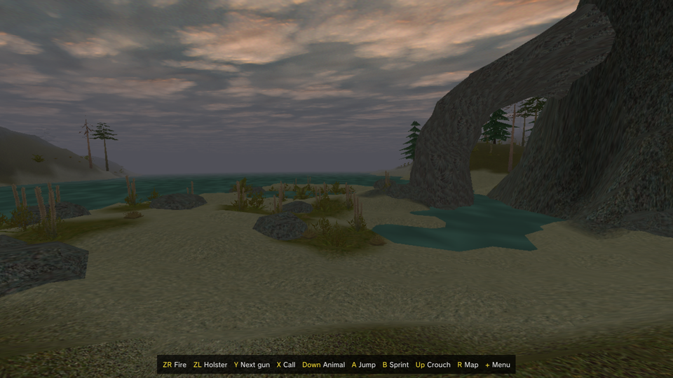

  

*Actual gameplay captured from the Rust reimplementation of Carnivores 2 (1998). Not footage from the original PC release.*

# Carnivores Classic, rebuilt in Rust for PC, 3DS and beyond

A fan-made, ground-up Rust rewrite of **Carnivores 2** (Action Forms, 1999), with a mod system that combines community add-ons automatically, and ports to the **Nintendo 3DS**, **Wii U** (demo) and **PC VR** (early).

You need your own copy of Carnivores 2. This project contains **no game files and no mod files**: only code, documentation and recipes (credits, download links and file hashes).

**v0.5.3:** [Download Windows ZIP or Linux TAR](https://github.com/isaiahboland-dotcom/Carnivores-Rust-Rewrite-and-ConsolePorts/releases/tag/v0.5.3) · [Release notes](docs/releases/v0.5.3.md) · [Changelog](CHANGELOG.md) · [Roadmap](docs/ROADMAP.md)

---

## Why this exists

Carnivores Classic is one of my favourite games. I grew up with it, and the tense feeling of hunting while possibly being hunted has stayed with me. This project is my way of showing how much I admire the game and the community that has kept it alive for over twenty-five years.

The goal is to make the game **more accessible while staying faithful to it**. The original behaviour is the vision: any difference is either a bug or a documented choice ([`docs/DECISIONS.md`](docs/DECISIONS.md)), never a quiet "improvement". If you want a fully modernized Carnivores, check out [Carnis](https://cce.carnivoressaga.com).

The project also explores what AI can do when adapting code to very different systems, from the original C++ to the 3DS's PICA200 GPU and the Wii U's PowerPC CPU. Much of the work was done together with Claude and ChatGPT.

---

## Features

The core game is the original Carnivores 2. These optional features go beyond it. Most are off by default.

- **Dynamic time:** an optional 60-minute day/night cycle, with night vision and a flashlight as equipment. See [Dynamic time](docs/DYNAMIC_TIME.md).
- **Predation:** an advanced setting where carnivores hunt herbivores. See [Predation](docs/MODDING.md#predation-carnivores-hunt-herbivores).
- **Survival:** Classic and Modded wave modes, and an optional hardcore night. See [Playing on PC](docs/PLAYING.md#survival).
- **Mods, combined automatically:** add-ons, Modder's Edition games, standalone games and mobile-game animals in one install. See [Modding](docs/MODDING.md) and [recipes](#mods-and-recipes).
- **Multi ammo, advanced observer and map zoom:** PC options for tranquilizer splits, free-flying observer hunts and a zoomable map. See [PC options](docs/PLAYING.md#pc-options).
- **3DS handheld settings:** "3DS friendly" animal detection range and a dinosaur run-speed slider. See [3DS](#nintendo-3ds).

---

## Screenshots

  

*Predation (optional): carnivores hunting herbivores during a hunt.*

  

*Night on Area 1 (dynamic time): the view at night, with the night-vision tint the renderer applies at full dark.*

<table>
  <tr>
    <th width="50%">PC (max settings)</th>
    <th width="50%">Android (medium settings)</th>
  </tr>
  <tr>
    <td></td>
    <td></td>
  </tr>
  <tr>
    <th width="50%">Nintendo 3DS</th>
    <th width="50%">Wii U (demo)</th>
  </tr>
  <tr>
    <td></td>
    <td></td>
  </tr>
</table>

*The same Carnivores 2 location from about the same viewpoint on each platform. These are screenshots of the Rust rewrite, not promotional renders. Differences come from rendering, resolution, draw distance and hardware, and the camera positions are not identical, so they illustrate the ports rather than benchmark them.*

---

## Status

| Platform | State | Notes |
|---|---|---|
| **PC** (Linux; Windows experimental) | Playable, feature-rich | The full original game, plus add-ons, Modder's Edition and standalone games, Carnivores: Ice Age, mobile-game animals, survival and a balance editor. Bugs mostly appear when many mods are combined. |
| **Nintendo 3DS** (homebrew) | Nearly complete | Full hunts, touch menus, bottom-screen map, sound, saves, trophy room, add-on and standalone packs, `.cia` installs. Tested on real 3DS and 2DS hardware. |
| **Wii U** (homebrew) | Demo, being optimized | Stock Carnivores 2: HD menus (TV and GamePad), all five maps, nine animals, six weapons, calls, radar and GamePad map. Runs on real hardware under Aroma (`.wuhb`) and exits to the HOME menu. Any game can be installed as its own Wii U Menu entry. |
| **PC VR** (OpenXR) | Early first draft | Menus, hunt setup and walking the areas, with animals that hunt you. No weapons yet. Tested with a PS VR2 on Linux through Monado. |
| **Android** | First build | The PC game in an APK, built from your own mobile APK (Dinosaur Hunter or Ice Age). Controller and touch controls work. Tested on an Android device. See [`android-ver/README.md`](android-ver/README.md). |
| **PS5 / PS VR2** | Not started | Research notes only: [`psvr2-ver/gameplan.md`](psvr2-ver/gameplan.md). |

Mobile conversion and mixed-mod compatibility still need gameplay testing. See the [roadmap](docs/ROADMAP.md) for current priorities.

---

## Get started on PC

1. Download the bundle for your system from the
   [v0.5.3 release](https://github.com/isaiahboland-dotcom/Carnivores-Rust-Rewrite-and-ConsolePorts/releases/tag/v0.5.3):
   [Windows (64-bit)](https://github.com/isaiahboland-dotcom/Carnivores-Rust-Rewrite-and-ConsolePorts/releases/download/v0.5.3/windows.zip)
   or [Linux (x86-64)](https://github.com/isaiahboland-dotcom/Carnivores-Rust-Rewrite-and-ConsolePorts/releases/download/v0.5.3/linux.tar).
2. Extract the **whole archive** into a writable folder and keep its files together.
3. Open `c2-launcher.exe` (Windows) or run `./c2-launcher` (Linux).
4. Choose **New instance**, select your own game folder (the one that contains `HUNTDAT/`), save, then press **Play**.

The download contains no game or mod files. Installation details, the launcher, the command line, controls and PC options are in [Playing on PC](docs/PLAYING.md). Windows specifics are in [Windows builds](docs/WINDOWS.md).

To build from source, install stable Rust and run `cargo run --release -p c2-launcher --bin c2-launcher` from `pc-ver/`. Linux needs the ALSA and udev development packages; see [Playing on PC](docs/PLAYING.md#build-from-source).

---

## Mods and recipes

Put a mod in its own folder (or a `.zip`) and add it to an instance. A **recipe** (`recipes/*.toml`) describes a modded game without containing any of it: each mod is listed with its author's credit, its download page and the SHA-256 of every file it uses, plus the load order and any conflict choices. Anyone can rebuild the same game from their own downloads.

| Recipe | What |
|---|---|
| `c2-mee-addons.toml` | ten add-on animals on the Modder's Edition Engine 1.1.1 |
| `c2-everything.toml` | every add-on, plus the mobile Dinosaur Hunter's and Ice Age's animals (APKs needed) |
| `c2-android.toml` | Carnivores 2 with the mobile Dinosaur Hunter's animals (APK needed) |
| `ice-age-android.toml` | Carnivores: Ice Age with the mobile Ice Age's animals (APK needed) |

Recipe steps, verification (`c2-pc recipe verify`) and how to make your own are in [Modding](docs/MODDING.md#recipes).

---

## Handheld and console ports

### Nintendo 3DS

Homebrew for the Old and New 3DS, built from your own files. Build steps, the menu, controls and the `.cia` installer are in [3DS](docs/3DS.md). Two optional settings on the title screen help with handheld play:

- **3DS friendly:** animals notice and chase you from 60% of the original distance (within 42 cells), so a far-off animal is not a few pixels to snipe. Off by default.
- **Dinosaur run speed:** a slider from 50% to 100% that slows every species equally. 100% is the original speed.

With both at their defaults, the hunt plays as the original does at the mobile view range (76 cells). The New 3DS draws all of it; the Old 3DS draws 56 cells.

### Wii U

A demo in Cemu and on real hardware under Aroma. The build steps are in [`wiiu-ver/perf-probe/README.md`](wiiu-ver/perf-probe/README.md), and the plan is in [WIIU.md](docs/WIIU.md).

### Android and PC VR

- **Android:** see [`android-ver/README.md`](android-ver/README.md). Controller bindings are in [`pc-ver/CONTROLLER.md`](pc-ver/CONTROLLER.md).
- **PC VR:** an early OpenXR build with its own plan in [`pc-ver/crates/c2-vr/GAMEPLAN.md`](pc-ver/crates/c2-vr/GAMEPLAN.md).

---

## Testing

- **Unit tests** (`cargo test --workspace` in `pc-ver/`, run by CI) use synthetic data only.
- **Gameplay regression scenarios** (`c2-regress`) play a scripted, deterministic hunt on your own game files and compare screenshots, state hashes and timings with a baseline and the published vanilla baselines. An optimization must leave the hashes unchanged; a fix that changes them has to say why.
- **Original-engine runs** play the same script in the original Carnivores 2 and Ice Age under Wine for a side-by-side comparison.

Details and what these do and do not prove: [Regression](docs/REGRESSION.md#validating-a-change). Contribution rules: [CONTRIBUTING.md](CONTRIBUTING.md).

---

## Repository layout

| Path | Contents |
|---|---|
| `pc-ver/` | Cargo workspace (stable Rust): shared crates, the PC game, the launchers, PC VR and the regression runner |
| `3ds-ver/` | the 3DS app and pack cooker (nightly Rust), reusing `pc-ver/crates` |
| `wiiu-ver/` | the Wii U probes and demo |
| `android-ver/` | the Android APK build of the PC game |
| `psvr2-ver/`, `steamdeck/` | PS VR2 research notes and the Steam Deck install script |
| `recipes/` | mod recipes: credits, links and hashes only |
| `docs/` | guides, decisions and the [spec](docs/DEVELOPMENT.md) |
| `source/` | **gitignored**: your own game, mods and reference material |

---

## Legal

- This is an unofficial fan project, not affiliated with or endorsed by Action Forms, Tatem Games, or any mod author.
- The repository contains no game data, mod files or original source code, and never will. You supply your own copy of the game and download mods from their authors.
- The original Carnivores 2 C++ source, released publicly in 2013, was used **as a reference only** to match behaviour and file formats. This is a rewrite, not a translation. The same goes for the Modder's Edition Engine's public source and manual.
- The code is under the [MIT License](LICENSE).

## Thanks

- **Action Forms**, for Carnivores 2 and for releasing its source.
- **The Carnivores modding community**: every add-on, map, skin and standalone game author, and the creators of the **Modder's Edition Engine** and its modernized fork. The recipes credit each mod's authors and link to their pages; please download from them and support their work.
- The homebrew toolchains this builds on: **devkitPro** (devkitARM, devkitPPC, libctru, citro3d, WUT), the **rust3ds** project, **rust-wiiu**, and **Monado** for open-source VR on Linux.
